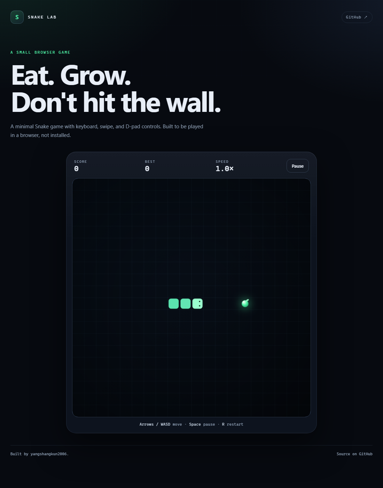

# Snake Lab

A small, playable Snake game for the browser. No install, no build step.

**[Play it →](https://yangshangkun2006.github.io/snake-lab/)**



## Controls

| Input | Action |
| --- | --- |
| Arrow keys / WASD | Move |
| Swipe on the board | Move (mobile) |
| D-pad | Move (mobile) |
| Space / P | Pause or resume |
| R | Restart |

## What's inside

- A 20×20 grid, keyboard + swipe + D-pad input
- Score, persistent best score, and a speed ramp
- Pause, game over, and restart states
- Canvas rendering with a light particle burst when you eat
- No framework, no dependencies, no build step

## Run locally

Because the game uses a `<canvas>` and `localStorage`, serve it over HTTP rather than opening the file directly:

```bash
python -m http.server 8000
```

Then open <http://localhost:8000>.

## How it works

The game state lives in `game.js`: a snake array, a direction queue, a food cell, and a fixed-timestep loop. Rendering is a separate pass on the same canvas, so the game logic stays small and easy to change.

Ideas for later: an AI autoplay mode, themes, sound, and a global leaderboard.

## License

MIT
